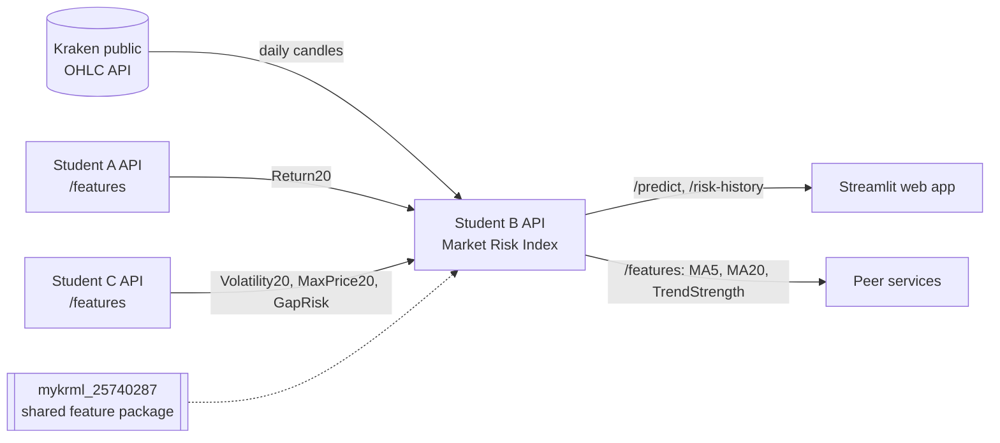
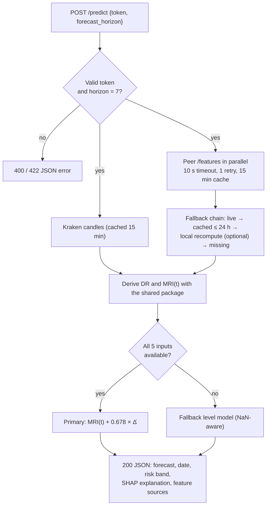

# Market Risk Index API

**7-day-ahead crypto market-risk forecasts with LightGBM: explained, resilient and contract-compliant.**


| | |
|---|---|
| **Live service** | https://group08-studentb-mri-api.onrender.com |
| **Interactive docs (Swagger)** | https://group08-studentb-mri-api.onrender.com/docs |
| **Group web app** | https://group08-crypto-intelligence.streamlit.app (Market Risk page) |
| **Subject** | 36120 Advanced Machine Learning Application, Spring 2026, University of Technology Sydney (AT3: Data Product with Machine Learning) |
| **Group / role** | Group 08, Student B: Market Risk Index (LightGBM regression) |
| **Experiment notebook** | [`36120-26SP-AT3-Group08-experiments`](https://github.com/vigneshcrack/36120-26SP-AT3-Group08-experiments) → `notebooks/student_b/36120_26SP_AT3_08_25740287_experiment.ipynb` |
| **Shared feature package** | [`mykrml-25740287` v0.3.0 on TestPyPI](https://test.pypi.org/project/mykrml-25740287/) |

> The free Render instance sleeps when idle. The first request after a quiet period can take about 50 seconds; call `/health` first to wake it.

---

## Contents
1. [Group members](#1-group-members)
2. [What the service does](#2-what-the-service-does)
3. [Model card](#3-model-card)
4. [Architecture and prediction flow](#4-architecture-and-prediction-flow)
5. [Quick start](#5-quick-start)
6. [API reference](#6-api-reference)
7. [Errors](#7-errors)
8. [Resilience design](#8-resilience-design)
9. [Configuration](#9-configuration)
10. [Testing and quality](#10-testing-and-quality)
11. [Deployment on Render](#11-deployment-on-render)
12. [Project structure](#12-project-structure)
13. [Reproducibility and maintenance](#13-reproducibility-and-maintenance)
14. [Troubleshooting](#14-troubleshooting)
15. [Responsible use](#15-responsible-use)
16. [AI usage acknowledgement](#16-ai-usage-acknowledgement)

---

## 1. Group members

| Role | Target | Student name | Student ID |
|---|---|---|---|
| Student A | Asset Performance Index – API | Ryan Cruikshank | 13191263 |
| **Student B** | **Market Risk Index – MRI (LightGBM Regressor) – this API** | **Vignesh Selvam** | **25740287** |
| Student C | Trend Category – TC | Nandeeswari Kumaravelu | 25980436 |
| Student D | Trading Opportunity Rating – TOR | Vinnie Bui | 26160438 |

---

## 2. What the service does

The service answers one question for an investor: **how risky will this cryptocurrency be one week from now?**

It forecasts the **Market Risk Index (MRI)** for **t + 7 days**. The MRI is a 0–100 score defined in the AT3 brief that combines four sources of downside risk:

```
MRI = 100 × ( 0.40 · min(Volatility20 / 0.10, 1)          volatility of daily returns, 20 days
            + 0.30 · min(DR / 0.40, 1)                     drawdown from the 20-day high
            + 0.20 · min(|min(Return20, 0)| / 0.30, 1)     losses over 20 days (gains ignored)
            + 0.10 · min(GapRisk / 0.10, 1) )              open-vs-previous-close gaps

DR = (MaxPrice20 − Close) / MaxPrice20
```

| Risk band (display aid) | Low | Moderate | High | Very high |
|---|---|---|---|---|
| MRI | < 20 | 20 – 40 | 40 – 60 | ≥ 60 |

**Supported tokens:** `BTC`, `ETH`, `XRP`, `SOL`, `DOGE`, `XLM`, `TRX`, `XMR`. One pooled model serves all eight, which extends the group product beyond the Bitcoin focus of the other services.

**Data source:** the Kraken public OHLC API (daily USD candles, the latest 720 complete days, no API key). The incomplete current day is always removed.

---

## 3. Model card

| Item | Detail |
|---|---|
| **Algorithm** | LightGBM regressor (`lightgbm==4.6.0`), two models in one bundle (`models/mri_lightgbm.joblib`) |
| **Primary model** | *Residual-on-persistence*: predicts the 7-day change Δ = MRI(t+7) − MRI(t); forecast = MRI(t) + **0.678** × Δ̂. Inputs: `Return20`, `Volatility20`, `DR`, `GapRisk`, `MRI(t)` |
| **Fallback model** | *Level model*: predicts MRI(t+7) directly from `Return20`, `Volatility20`, `DR`, `GapRisk`, trained with missing-feature augmentation so it can predict when peer features are missing |
| **Training data** | 5,544 labelled token-days (8 tokens × 693 days), 22 Nov 2024 – 15 Oct 2026, Kraken snapshot of 23 Oct 2026 |
| **Validation protocol** | Chronological 70/15/15 split with 7-day purge gaps. Optuna (TPE, seed 42, median pruner) tuned on 5 purged time-series folds of the training period only. Test set scored once |
| **Tuned settings (primary)** | absolute-error loss, learning rate 0.0061, 317 trees, 32 leaves, depth 10, min_child_samples 167 |
| **Deployed model** | Both models refitted on all labelled data with the selected settings (deterministic training) |

**Performance (test period 4 Jul – 15 Oct 2026, 832 token-days, evaluated once)**

| Model | MAE | RMSE | R² |
|---|---|---|---|
| **This model (primary)** | **3.70** | **5.10** | **0.63** |
| Persistence ("risk next week = risk today") | 3.91 | 5.38 | 0.59 |
| Training mean | 11.29 | – | – |

- **5.3 % lower error than persistence** on test, consistent with cross-validation (5.4 %) and validation (4.7 %).
- **84 %** of test days are placed in the correct risk band (persistence: 82 %).
- On the riskiest 25 % of days, large under-predictions (more than 10 points) fall from 14.9 % to 11.1 %.
- **Accuracy by token:**
  - better than persistence on XLM (+14 %), XMR (+11 %), DOGE (+9 %) and SOL (+9 %)
  - about the same on XRP and TRX
  - **worse on BTC (−7 %) and ETH (−9 %)**

**Accuracy when peer features are missing** (test MAE, before the cache and local fallbacks in §8)

| All features | Student A down | Student C down | Both down |
|---|---|---|---|
| 3.70 | 4.40 | 9.26 | 11.00 |

**Limitations**
- Risk is very persistent, so most of the forecast comes from today's level.
- The test period was calm: 9 "High" days and no "Very high" days. Behaviour in a crash is therefore unproven.
- Sudden shocks (exchange failures, regulatory news) cannot be anticipated from price data.
- GapRisk is almost always zero in 24/7 markets, so it carries little information.

All metadata above is served live by `GET /model-metadata`, which reads `models/metrics.json` written by the notebook. Nothing is typed by hand.

---

## 4. Architecture and prediction flow





---

## 5. Quick start

**Requirements:** Git and [uv](https://docs.astral.sh/uv/). uv installs Python 3.12.13 and the pinned packages.

```bash
git clone https://github.com/vigneshcrack/36120-26SP-AT3-Group08-StudentB-api.git
cd 36120-26SP-AT3-Group08-StudentB-api
uv python install 3.12.13
uv sync                                   # pinned dependencies, incl. mykrml-25740287 from TestPyPI
uv run uvicorn app.main:app --reload      # → http://127.0.0.1:8000/docs
```

**Without uv:**
```bash
python -m venv .venv
source .venv/bin/activate                 # Windows PowerShell: .venv\Scripts\Activate.ps1
pip install -r requirements.txt
uvicorn app.main:app --reload
```

**Connect the peer services (optional).** In PowerShell, use `$env:STUDENT_A_URL="https://..."`:
```bash
export STUDENT_A_URL=https://<student-a-service>.onrender.com
export STUDENT_C_URL=https://<student-c-service>.onrender.com
export PEER_FALLBACK_MODE=local           # recompute missing peer features locally
```

**First request:**
```bash
curl -X POST https://group08-studentb-mri-api.onrender.com/predict \
     -H "Content-Type: application/json" \
     -d '{"token": "BTC", "forecast_horizon": 7}'
```

---

## 6. API reference

All endpoints return JSON. A successful call returns **HTTP 200**. Request and response models are documented with examples at `/docs`.

| Method | Path | Purpose |
|---|---|---|
| GET | `/` | Service metadata, owner and endpoint list |
| GET | `/health` | Liveness and readiness: model loaded, model version, peers configured |
| POST | `/features` | Student B's engineered features for peers: `MA5`, `MA20`, `TrendStrength` |
| POST | `/predict` | 7-day MRI forecast with explanation and feature provenance |
| GET | `/model-metadata` | Target, algorithm, features, importance, metrics, hyperparameters |
| POST | `/risk-history` | Realised daily MRI and its four weighted components (for charts) |
| GET | `/docs` | Interactive OpenAPI documentation |

### `POST /predict`

**Request**

| Field | Type | Required | Rule |
|---|---|---|---|
| `token` | string | yes | one of the 8 supported symbols (case-insensitive) |
| `forecast_horizon` | integer | no (default 7) | must be `7` |

**Response:** a live example captured on 25 Oct 2026. The `explanation` values are illustrative.

```json
{
  "prediction": 14.74,
  "forecast_horizon": 7,
  "prediction_date": "2026-10-31",
  "token": "BTC",
  "as_of_date": "2026-10-24",
  "current_mri": 15.49,
  "risk_level": "Low",
  "model_used": "primary",
  "model_version": "1.0.0",
  "missing_features": [],
  "feature_sources": {
    "Return20": "local_fallback (shared package)",
    "Volatility20": "local_fallback (shared package)",
    "MaxPrice20": "local_fallback (shared package)",
    "GapRisk": "local_fallback (shared package)",
    "DR": "derived: MaxPrice20 + Kraken close",
    "MRI": "derived: brief formula"
  },
  "inputs": {"Return20": -0.0663, "Volatility20": 0.0143, "MaxPrice20": 86973.6, "GapRisk": 0.00002, "DR": 0.081, "MRI": 15.49},
  "explanation": {
    "baseline": 15.20,
    "contributions": {"Return20": 0.62, "Volatility20": -0.71, "DR": -0.25, "GapRisk": 0.01, "MRI": -0.13},
    "method": "LightGBM SHAP values of the predicted 7-day change, scaled by the shrink factor and added to today's MRI"
  }
}
```

| Field | Meaning |
|---|---|
| `prediction` | Forecast MRI (0–100) on `prediction_date` |
| `as_of_date` / `prediction_date` | Latest complete daily candle / `as_of_date` + 7 days |
| `current_mri` | Today's MRI (`null` if an input is missing) |
| `risk_level` | Band of the forecast: Low, Moderate, High or Very high |
| `model_used` | `primary` (all inputs available) or `fallback` |
| `missing_features` | Inputs that could not be obtained |
| `feature_sources` | Where each input came from: `student_a_api`, `student_c_api`, `… (cached, N min old)`, `local_fallback (shared package)` or `unavailable` |
| `explanation` | Exact TreeSHAP contributions: `baseline + Σ contributions = prediction` |

### `POST /features`

Request: `{"token": "ETH", "forecast_horizon": 7, "history_days": 30}`. `history_days` is optional, from 1 to 365, default 1.

The response contains Student B's latest `MA5`, `MA20` and `TrendStrength`, plus `history` (oldest first, including `close`). Values that cannot be computed are `null`, never `NaN`.

### `GET /model-metadata`

Returns:
- `target`, `target_description`, `algorithm`, `forecast_horizon`, `features`
- `feature_importance` (gain share) and `permutation_importance_test_mae_increase`
- `classification_labels` (`null` for regression)
- `metrics`, `degradation_test_mae`, `hyperparameters`, `search_space`, `optuna`, `shrink`
- `training_period`, `test_period`, `model_version`, `created_at`

### `POST /risk-history`

Request: `{"token": "SOL", "forecast_horizon": 7, "days": 90}`. `days` runs from 1 to 690.

The response holds daily `MRI` and its weighted parts (`volatility_points`, `drawdown_points`, `downside_return_points`, `gap_risk_points`), which add up to the index.

---

## 7. Errors

Every error uses the same JSON shape. No request ever returns a stack trace.

| Situation | Status | Body |
|---|---|---|
| Unknown token | 400 | `{"error": "Unsupported cryptocurrency", "token": "ADA", "supported_tokens": ["BTC", …]}` |
| `forecast_horizon` ≠ 7 | 422 | `{"error": "Unsupported forecast_horizon", "forecast_horizon": 30, "supported_horizons": [7]}` |
| Missing or invalid fields | 422 | `{"error": "Invalid request", "details": [{"field": "token", "message": "Field required"}]}` |
| Kraken unreachable, no cached data | 503 | `{"error": "Market data source unavailable", "detail": "…", "retry_after_seconds": 60}` |
| Unknown path | 404 | `{"error": "Not Found"}` |
| Unexpected failure | 500 | `{"error": "Internal server error"}` (logged server-side) |

**A peer service being down is not an error.** The forecast is still returned with HTTP 200, the backup used is reported in `feature_sources`, and any missing inputs are listed in `missing_features`.

---

## 8. Resilience design

| Layer | Mechanism | Effect |
|---|---|---|
| Market data | Kraken candles cached 15 min; last good download served if Kraken fails | Fewer calls, survives short Kraken outages |
| Peer calls | Parallel `httpx` requests, 10 s timeout, 1 retry, 15 min cache | A slow peer cannot block the response |
| Fallback 1 | Peer's last successful answer (≤ 24 h), labelled `cached` | No accuracy loss during short outages or cold starts |
| Fallback 2 | `PEER_FALLBACK_MODE=local`: recompute the feature from Kraken with the shared package, labelled `local_fallback` | Same definitions as the peers, so accuracy is unaffected. Also gives coverage of tokens the peers do not serve |
| Fallback 3 | Missing values with the NaN-aware fallback model | A forecast is always returned. Degradation is measured (§3) |
| Start-up | Model bundle and metrics loaded once, at start-up | Fails fast if an artefact is missing |

The deployed instance runs with `PEER_FALLBACK_MODE=local` because the peer services forecast Bitcoin only.

---

## 9. Configuration

All settings come from environment variables. No URL or secret is hard-coded.

| Variable | Default | Purpose |
|---|---|---|
| `STUDENT_A_URL` | – | Base URL of Student A's API (provides `Return20`) |
| `STUDENT_C_URL` | – | Base URL of Student C's API (provides `Volatility20`, `MaxPrice20`, `GapRisk`) |
| `PEER_FALLBACK_MODE` | `missing` | `missing` predicts with missing values, as the brief requires. `local` recomputes unavailable peer features with the shared package |
| `PEER_TIMEOUT_SECONDS` | `10` | Timeout per peer call |
| `PEER_RETRIES` | `1` | Extra attempts after a failed peer call |
| `PEER_CACHE_SECONDS` | `900` | Reuse a successful peer response without calling again |
| `STALE_PEER_MAX_AGE_SECONDS` | `86400` | Maximum age of a cached peer response used during an outage |
| `MARKET_CACHE_SECONDS` | `900` | Reuse Kraken candles for this long |
| `GITHUB_URL` | this repository | Link reported by `GET /` |
| `PYTHON_VERSION` (Render) | – | Set to `3.12.13` |

---

## 10. Testing and quality

```bash
uv run pytest          # 23 tests, offline
uv run ruff check .    # lint
```

The suite runs without network access. Kraken is replaced by **real candles stored in `tests/fixtures/`**, and the peer services by deterministic stand-ins. It covers:

- **The brief's contract:** endpoints, required keys, `prediction_date = as_of_date + 7`, and metadata read from `metrics.json`.
- **Correctness:** the `/predict` value equals the saved model's own calculation, SHAP contributions add up to the forecast, and the risk-history components add up to the MRI.
- **Resilience:** Student A down, both peers down, a cached peer response reused, the local fallback mode, and Kraken down (503).
- **Validation:** an unsupported token, horizons 1/6/8/30, malformed and missing fields, an out-of-range `history_days`, and an unknown route.

---

## 11. Deployment on Render

1. Push this repository to GitHub (private). Give Render access to it under **GitHub → Settings → Applications → Render → Configure**.
2. **Render → New → Web Service** → select the repository → branch `main`.
3. Settings:

| Setting | Value |
|---|---|
| Language | Python 3 |
| Build command | `pip install -r requirements.txt` |
| Start command | `uvicorn app.main:app --host 0.0.0.0 --port $PORT` |
| Health check path | `/health` |
| Instance type | Free |
| Environment | `PYTHON_VERSION=3.12.13`, `PEER_FALLBACK_MODE=local`, and `STUDENT_A_URL` / `STUDENT_C_URL` once the peers are live |

4. **Deploy.** Then open `<URL>/docs` and run `/predict`. Each later push to `main` redeploys automatically.

Alternatively, use the included **`render.yaml`** blueprint: **New → Blueprint**.

`requirements.txt` keeps `--extra-index-url https://test.pypi.org/simple/` so Render can install the shared package from TestPyPI.

---

## 12. Project structure

```
├── app/
│   ├── main.py      # FastAPI app and routes (thin: validation → services → response)
│   ├── model.py     # loads the bundle; primary/fallback selection; SHAP explanations
│   ├── peers.py     # async peer client: timeout, retry, cache, stale fallback
│   ├── market.py    # Kraken candles (cached), Student B features, risk history
│   ├── schemas.py   # Pydantic request/response models (documented in /docs)
│   ├── errors.py    # brief-format JSON errors and exception handlers
│   └── config.py    # environment settings and artefact paths
├── models/
│   ├── mri_lightgbm.joblib   # primary + fallback LightGBM, shrink factor, feature lists
│   └── metrics.json          # metadata and metrics written by the experiment notebook
├── tests/                    # pytest suite + real-data fixture (tests/fixtures/)
├── requirements.txt          # pinned, for Render
├── pyproject.toml, uv.lock   # uv project (Python 3.12.13)
├── render.yaml               # optional Render blueprint
└── README.md
```

---

## 13. Reproducibility and maintenance

- **Training:** run the experiment notebook in the experiments repository. It writes `mri_lightgbm.joblib` and `metrics.json`. Copy both into `models/` and redeploy. Training is deterministic (`deterministic=True`, `force_row_wise=True`, seed 42).
- **Versions:** pinned as required by the brief (Python 3.12.13, pandas 2.2.2, scikit-learn 1.6.1, LightGBM 4.6.0, FastAPI 0.139.0, uvicorn 0.50.0, joblib 1.5.3).
- **Retraining:** retrain monthly on the latest 720 days. Monitor rolling MAE against persistence, and fall back to persistence if the model stops adding value for several weeks.
- **Changing features or responses:** this must follow the group `CONTRACT.md` (a pull request in the experiments repository).

---

## 14. Troubleshooting

| Symptom | Cause and fix |
|---|---|
| First request takes 30–60 s | Render free instance waking up; call `/health` first |
| `model_used: "fallback"` and `null` inputs | Peers unreachable and `PEER_FALLBACK_MODE=missing`; set peer URLs or `PEER_FALLBACK_MODE=local` |
| `"cached, N min old"` in `feature_sources` | A peer was briefly unavailable; its last answer was reused (expected) |
| 503 "Market data source unavailable" | Kraken unreachable or rate-limited; retry after a minute |
| Build fails to find `mykrml-25740287` | Keep the `--extra-index-url https://test.pypi.org/simple/` line in `requirements.txt` |
| Start-up error loading the model | `models/mri_lightgbm.joblib` and `models/metrics.json` must be committed |
| Wrong Python on Render | Set `PYTHON_VERSION=3.12.13` and redeploy |

---

## 15. Responsible use

This service provides **general information for educational purposes, not financial advice**:
- It forecasts price-based risk only, not liquidity, custody or counterparty risk.
- Its accuracy is reported against simple baselines, including where it is worse than persistence (BTC, ETH).
- It collects no personal data.

Any extension that stores user information must comply with the *Privacy Act 1988* (Cth). It should also follow Indigenous data-sovereignty principles (CARE; Maiam nayri Wingara) for any data relating to Aboriginal and Torres Strait Islander users.

---

## 16. AI usage acknowledgement

Generative AI (Claude) was used to support the design, coding, testing and documentation of this service, in line with the subject's AI usage policy. All code was reviewed, executed and tested by the student, who can explain and justify every design decision.
